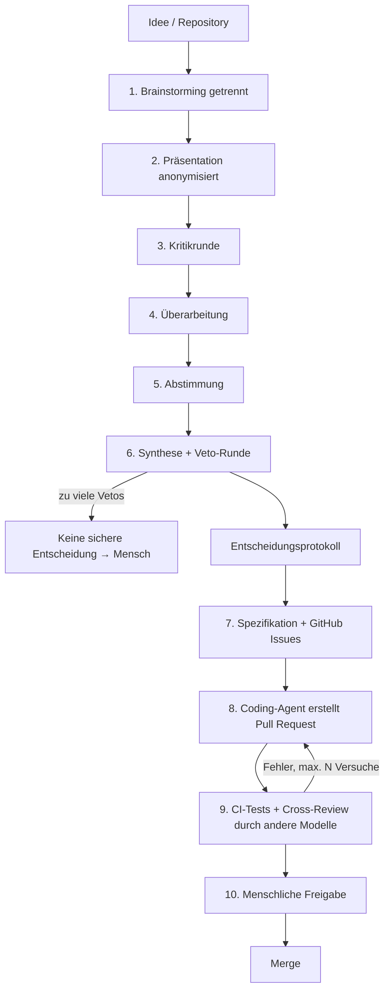

# AI Development Board – Konzept

> **Status:** Konzept · **Erstellt:** 25. Oktober 2026 · **Owner:** Eddy
>
> Mehrere KI-Modelle arbeiten wie ein Expertenteam: Sie entwickeln unabhängig Lösungen, kritisieren sich gegenseitig, stimmen anonym ab und setzen die beschlossene Lösung anschliessend als geprüften Pull Request um.

## Inhalt

1. [Vision](#1-vision)
2. [Ablauf](#2-ablauf)
3. [Neutralität und echte Kritik](#3-neutralität-und-echte-kritik)
4. [Umsetzungsphase](#4-umsetzungsphase)
5. [Architekturentscheide](#5-architekturentscheide)
6. [Technische Architektur](#6-technische-architektur)
7. [Risiken](#7-risiken)
8. [Erfolgsmessung: Vergleichsmodus](#8-erfolgsmessung-vergleichsmodus)
9. [MVP – erste Version](#9-mvp--erste-version)
10. [Roadmap](#10-roadmap-grobe-schätzung)
11. [Produktrichtung](#11-produktrichtung)
12. [Bestehende Ansätze](#12-bestehende-ansätze)
13. [Offene Fragen](#13-offene-fragen)

---

## 1. Vision

Das AI Development Board ist eine Webplattform, auf der ein Nutzer eine Idee, Anforderungen oder ein GitHub-Repository einreicht. Mehrere KI-Modelle, frei wählbar und einzeln oder in Teams, erarbeiten Lösungen, hinterfragen sich gegenseitig und kommen zu einer nachvollziehbaren Entscheidung. Die beschlossene Lösung wird danach von Coding-Agenten umgesetzt, von Modellen anderer Anbieter geprüft und als Pull Request bereitgestellt.

**Kernprinzip:** Die KIs sollen sich nicht einfach zustimmen, sondern echte Gegenprüfung leisten. Das Ergebnis ist kein blosser Mehrheitsentscheid, sondern ein Entscheidungsprotokoll mit Begründungen, Gegenargumenten und offenen Risiken.

**Alleinstellungsmerkmal:** die anbieterübergreifende Entscheidungs- und Prüfschicht, nicht das Programmieren selbst.

## 2. Ablauf



### Entscheidungsphase

| Phase | Was passiert | Regel |
|---|---|---|
| **1. Brainstorming** | Jede KI bzw. jedes Team erarbeitet parallel eine eigene Lösung. | Kein Einblick in andere Lösungen, um Gruppendenken zu vermeiden. |
| **2. Präsentation** | Alle Lösungen werden allen Teilnehmern gezeigt. | Anonymisiert als Lösung A, B, C. Reihenfolge pro KI zufällig. |
| **3. Kritikrunde** | Jede KI nennt Schwächen der anderen Lösungen und stellt «Warum?»-Fragen. Die Autoren antworten. | Mindestanzahl konkreter Kritikpunkte. Technische Behauptungen brauchen einen Nachweis (Code, Tests, Dokumentation). |
| **4. Überarbeitung** | Jede KI passt ihre Lösung an und darf Ideen der anderen übernehmen. | Änderungen werden begründet und protokolliert. |
| **5. Abstimmung** | Jede KI erstellt eine Rangliste nach festen Kriterien, mit Begründung. | Geheim und anonym. Keine Stimme für die eigene Lösung. Auswertung z. B. per Borda-Zählung. |
| **6. Synthese + Veto** | Ein Vorsitz-Modell führt die Siegerlösung mit den besten Ideen der anderen zusammen. Danach gibt jede KI Zustimmung oder ein begründetes Veto. | Keine erzwungene Einigkeit: Einwände werden als Minderheitsmeinung dokumentiert. Bei vielen Vetos lautet das Ergebnis «keine sichere Entscheidung» und geht zurück an den Menschen. |

### Bewertungskriterien (Vorschlag)

- Korrektheit und technische Machbarkeit
- Sicherheit und Datenschutz
- Entwicklungs- und Betriebskosten
- Wartbarkeit und Einfachheit
- Passung zu den Anforderungen

Die Gewichtung ist pro Projekt durch den Nutzer einstellbar.

### KI-Teams

Statt Einzelmodellen können Teams antreten, z. B. Team A (Claude + GPT) gegen Team B (Gemini + Mistral). Innerhalb eines Teams entwirft ein Modell, das andere hinterfragt. Danach präsentiert das Team gemeinsam. Rollen sind nicht an Modelle gebunden: Dieselbe Modellfamilie kann auch mehrere Rollen übernehmen.

## 3. Neutralität und echte Kritik

Mehrere KIs garantieren nicht automatisch bessere Ergebnisse. Sie können dieselben Fehler machen, sich gegenseitig beeinflussen oder aus Höflichkeit zustimmen. Diese Regeln sind deshalb fest im System verankert:

| Problem | Gegenmassnahme |
|---|---|
| **Selbstbevorzugung:** Modelle bewerten eigene Texte besser | Anonymisierung, keine Stimme für die eigene Lösung |
| **Positionsbias:** Die zuerst gezeigte Lösung wird bevorzugt | Reihenfolge für jede KI zufällig mischen |
| **Höflichkeit:** Modelle einigen sich zu schnell | Feste Rollen (z. B. Advocatus Diaboli), Pflicht zur Kritik mit Mindestanzahl Punkte |
| **Längenbias:** Längere Antworten wirken besser | Längenlimit pro Beitrag |
| **Scheinbare Vielfalt:** ähnliche Trainingsdaten | Modelle verschiedener Anbieter mischen |
| **Behauptungen ohne Beleg** | Beweispflicht: Code, Tests oder Dokumentation |
| **Erzwungener Konsens** | Minderheitsmeinung erlaubt, Ergebnis «keine sichere Entscheidung» möglich |

## 4. Umsetzungsphase

Nach der Entscheidung wird die Lösung in konkrete Aufgaben zerlegt und umgesetzt:

1. Spezifikation und Aufgaben werden als GitHub Issues angelegt.
2. Ein bestehender Coding-Agent (z. B. Claude Code, Codex oder GitHub Copilot Coding Agent) arbeitet in einer isolierten Umgebung und erstellt einen Pull Request.
3. Die CI führt automatische Tests und statische Codeanalyse aus.
4. Modelle anderer Anbieter prüfen den PR auf Qualität, Sicherheit und Architekturtreue.
5. Fehler werden korrigiert und erneut getestet, mit einer maximalen Anzahl Versuche.
6. Das Ergebnis fliesst zurück ins Board. Gemergt wird nur nach menschlicher Freigabe.

### Rollen

| Rolle | Verantwortung | Umfang |
|---|---|---|
| AI Decision Chair | Moderation, Synthese, Entscheidungsvorbereitung | ✅ MVP |
| AI Architect | Technische Architektur (Board-Mitglieder) | ✅ MVP |
| AI Developer | Programmierung (bestehender Coding-Agent) | ✅ MVP |
| AI Code Reviewer | Unabhängige Codeprüfung durch anderen Anbieter | ✅ MVP |
| AI Product Manager | Anforderungen und Funktionsumfang | ⏳ Später (im MVP durch Vorsitz) |
| AI Security Engineer | Sicherheitskontrollen | ⏳ Später (im MVP Teil des Reviews) |
| AI QA Engineer | Tests und Fehleranalyse | ⏳ Später (im MVP durch CI) |

Sieben Rollen pro Lauf vervielfachen Kosten und Wartezeit. Für das MVP reichen vier.

## 5. Architekturentscheide

Alle Punkte haben den Status **Vorschlag**.

| Thema | Empfehlung | Begründung |
|---|---|---|
| **Plattform** | Webplattform als Zentrale, plus GitHub | SaaS-fähig. PRs lassen sich mit der GitHub-Extension bereits in VS Code öffnen. |
| **VS Code** | Eigene Extension erst später | Kostet Wochen und bringt in v1 kaum Mehrwert. Erst bauen, wenn Nutzer danach fragen. |
| **Coding-Agenten** | Bestehende Agenten orchestrieren, nicht selbst bauen | Isolierte Umgebungen, Dateibearbeitung und Testschleifen entwickeln Anthropic, OpenAI und GitHub mit grossen Teams. |
| **Stack** | Next.js, TypeScript, Tailwind, Firebase | Eigener Stack, damit schnellere Umsetzung. Alternative: Python, FastAPI, LangGraph, PostgreSQL. |
| **Orchestrierung** | Eigene Zustandsmaschine in TypeScript | Der Ablauf ist eine feste Phasenfolge. Ein Framework wie LangGraph ist nicht zwingend. |
| **Modellzugang** | Adapter-Schicht, via OpenRouter oder direkte Provider-APIs | Eine Schnittstelle für viele Modelle, freie Auswahl für den Nutzer. |
| **Echtzeit** | Firestore-Listener | Live-Debatte ohne eigene WebSocket- oder SSE-Infrastruktur. |
| **GitHub** | GitHub App und API, Änderungen nur als PR | Kein ungeprüfter Code im Hauptbranch. |

## 6. Technische Architektur

- **Frontend (Next.js):** Projekte, Modellauswahl, Teams, Live-Debatte, Abstimmung, Entscheidungsprotokoll
- **Orchestrator:** steuert die Phasen. Jede Phase läuft als eigener Hintergrundjob, damit lange Debatten keine Zeitlimits sprengen.
- **Model-Adapter:** einheitliche Schnittstelle für Claude, GPT, Gemini, Mistral, DeepSeek usw.
- **Kontext-Builder:** wählt bei grossen Repositories nur die relevanten Dateien aus
- **GitHub-Integration:** Repository lesen, Issues, Branches und PRs anlegen, CI-Ergebnisse lesen
- **Agent-Bridge:** übergibt Aufgaben an Coding-Agenten und holt die Ergebnisse zurück
- **Budget-Wächter:** Token- und Kostenlimit sowie maximale Rundenzahl pro Session

### Datenmodell (Skizze, Firestore)

```text
projects/{projectId}
  name, repoUrl, criteria[], allowedModels[]

sessions/{sessionId}
  projectId, task, status, currentPhase, budget, costSoFar
  participants/{id}    modelId, role, teamId
  contributions/{id}   phase, participantId, anonLabel, content
  critiques/{id}       fromId, targetLabel, points[], questions[], answers[]
  votes/{id}           voterId, ranking[], reasons
  decision             winner, synthesis, vetos[], minorityOpinions[], confidence
  tasks/{taskId}       issueUrl, prUrl, ciStatus, reviews[], attempts
```

## 7. Risiken

| Risiko | Gegenmassnahme |
|---|---|
| **Datenschutz:** Jedes zusätzliche Modell ist ein weiterer Anbieter, der den Code sieht. Schweizer Hosting hilft wenig, wenn der Code an US-APIs geht. | Modellauswahl pro Projekt einschränkbar. Transparente Anzeige, welche Anbieter Daten erhalten. |
| **Testbetrug:** Coding-Agenten schwächen Tests ab, damit sie grün werden. | Änderungen an Testdateien separat prüfen oder für den Entwickler-Agenten sperren. |
| **Endlose Korrekturschleifen** | Maximale Anzahl Versuche, danach Übergabe an den Menschen. |
| **Kosten:** z. B. 4 Modelle × 6 Runden mit Code-Kontext | Budget-, Token- und Rundenlimit pro Session. |
| **Wartezeit** | Phasen wo möglich parallelisieren, Fortschritt live anzeigen. |
| **Board ist nicht besser als ein Einzelmodell** | Vergleichsmodus (siehe Abschnitt 8). |
| **Konkurrenz durch grosse Anbieter** | Fokus auf die anbieterübergreifende Entscheidungs- und Prüfschicht. |

## 8. Erfolgsmessung: Vergleichsmodus

Dieselbe Aufgabe läuft einmal mit einem einzelnen Modell und einmal mit dem Board. Verglichen werden Testergebnisse, im Review gefundene Fehler, Kosten und Dauer.

> [!WARNING]
> Ist das Board nicht messbar besser als ein einzelnes starkes Modell, hat das Produkt keinen Grund zu existieren. Ist es besser, ist genau das das stärkste Verkaufsargument.

## 9. MVP – erste Version

1. Repository und Aufgabe eingeben
2. Drei Modelle: Brainstorming, Kritik, anonyme Abstimmung, Entscheidungsprotokoll
3. Die Entscheidung wird als Spezifikation und Issue in GitHub angelegt
4. Ein bestehender Coding-Agent erstellt den Pull Request, die CI testet
5. Zwei andere Modelle prüfen den PR, das Ergebnis fliesst zurück ins Board

### Nicht im MVP

- Eigene VS-Code-Extension
- Eigene Sandboxes und Coding-Agenten
- Alle sieben Rollen
- KI-Teams mit mehreren Modellen pro Lösung
- Automatische Deployments
- Nutzerkonten und Abrechnung

## 10. Roadmap (grobe Schätzung)

| Phase | Inhalt | Dauer |
|---|---|---|
| **0 – Prototyp** | Entscheidungsphase mit drei Modellen, ohne GitHub | 1–2 Wochen |
| **1 – MVP** | Voller Ablauf bis zum geprüften PR, inkl. Vergleichsmodus | 4–8 Wochen |
| **2 – Ausbau** | KI-Teams, zusätzliche Rollen, Nutzerkonten | weitere 4–8 Wochen |
| **3 – SaaS** | Abrechnung, Firmenfunktionen, VS-Code-Extension | insgesamt 3–6 Monate oder länger |

## 11. Produktrichtung

Gemeinsamer technischer Kern, aber zuerst eine klare Zielgruppe: das **Developer Decision Board** für Architekturentscheide, Code Reviews und Bugfixes. Entwickler sind der beste Start, weil sich die Qualität der Entscheidungen über Tests und Codeprüfungen messen lässt. Später folgt ein **Universal Decision Board** für Geschäftsideen, Strategie und Marketing.

## 12. Bestehende Ansätze

- **[llm-council](https://github.com/karpathy/llm-council)** (Andrej Karpathy, Open Source): Antworten, anonyme gegenseitige Bewertung und Zusammenfassung durch einen Vorsitz. Deckt einen vereinfachten Teil der Entscheidungsphase ab.
- **Multi-Agent-Frameworks** wie LangGraph, CrewAI und AutoGen
- **Coding-Agenten** wie Claude Code, Codex und GitHub Copilot Coding Agent

**Abgrenzung:** die Kombination aus unabhängigem Brainstorming, echter Gegenprüfung, anonymem Voting, KI-Teams, GitHub-Integration und Umsetzung bis zum geprüften Pull Request.

## 13. Offene Fragen

- [ ] Zielgruppe für v1 bestätigen (Developer Decision Board?)
- [ ] Modelle für v1 festlegen
- [ ] Coding-Agent für die Umsetzung wählen
- [ ] Bewertungskriterien und Gewichtung definieren
- [ ] Budgetlimit pro Session festlegen
- [ ] Datenschutzkonzept für Firmenkunden
- [ ] Produktnamen festlegen
- [ ] Datenmodell und Prompts pro Phase ausarbeiten
